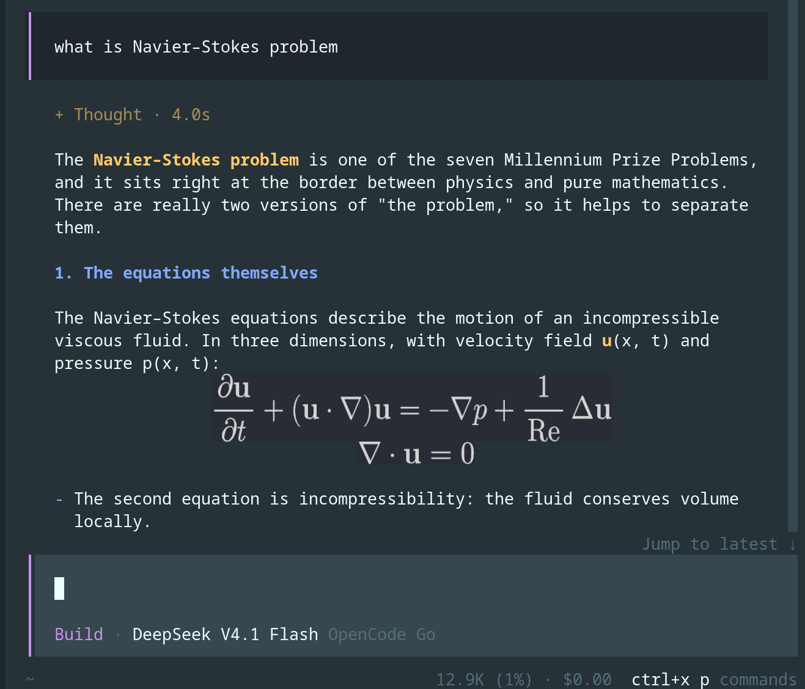
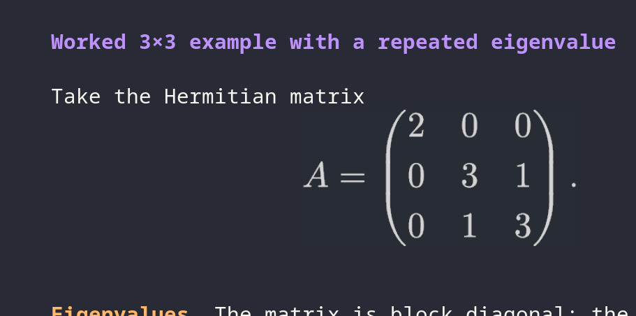

# opencode-latex

Render readable LaTeX in OpenCode v2 terminal conversations.

`opencode-latex` has two coordinated parts:

- The server plugin teaches agents to use compact Unicode for simple inline math and fenced `latex` blocks for longer expressions.
- The TUI plugin renders those blocks with [`opentui-math`](https://opentui-math.dev/) through OpenTUI's image pipeline.

Graphical output uses Kitty graphics in terminals such as Ghostty and Kitty, or SIXEL in compatible xterm.js terminals such as `obsidian-opencode`. Other terminals and multiplexers receive a selectable Unicode-cell fallback.

## OpenCode's built-in renderer

OpenCode 2.2.2 includes a built-in [`opencode.latex` plugin](https://github.com/anomalyco/opencode/blob/v2.2.2/packages/latex/src/plugin.ts). It renders `latex` and `math` fences with Unicode terminal cells. Use it when Unicode output and basic formula layout meet your needs. No extra package is required.

Use this package for MathJax image rendering, including nested expressions and derivations that need graphical layout. It uses Kitty graphics or SIXEL, with a Unicode-cell fallback. In OpenCode 2.2.2, external renderer registrations take precedence over built-in registrations. This package owns `latex`; the built-in renderer continues to handle `math`.

The built-in renderer is confirmed in 2.2.2. This does not identify its first release version. No upstream image-rendering roadmap is assumed here.

## Demo



*Rendered equations stay aligned with the surrounding conversation.*



*Larger matrices and derivations remain crisp and readable.*

> [!NOTE]
> Kitty preserves PNG transparency. SIXEL uses OpenTUI's native transparency handling, which cannot reproduce Kitty's alpha compositing exactly.

## Requirements

- OpenCode 2.2.2 with OpenTUI Core 0.7.x
- A terminal with Kitty graphics or SIXEL for graphical output
- No external TeX installation; MathJax performs the rendering

## Install

Install the package globally through OpenCode:

```sh
opencode plugin add opencode-latex@0.2.1
```

Alternatively, add it to `opencode.jsonc`:

```jsonc
{
  "$schema": "https://opencode.ai/config.json",
  "plugins": ["opencode-latex@0.2.1"]
}
```

The package's `./tui` companion loads automatically. Restart OpenCode after installing or updating the package.

Version 0.2.1 targets OpenCode 2.2.2 and Core 0.7.x. It replaces the old Core `<0.6.0` workaround. Older hosts are not supported by this release.

The server ID is `io.github.kriss-spy.opencode-latex`. The TUI ID is `io.github.kriss-spy.opencode-latex.tui`. Package configuration paths stay the same. If you use ID-based enable/disable selectors, update the old `opencode.latex.tui` selector to the new TUI ID. `opencode.latex` now refers only to OpenCode's built-in renderer.

OpenCode stores preferences under the TUI plugin ID. The old render-mode preference does not migrate automatically. Select your preferred mode again after upgrading; until then, the configured `graphicsMode` applies.

For local development, configure the repository path instead:

```jsonc
{
  "$schema": "https://opencode.ai/config.json",
  "plugins": ["/absolute/path/to/opencode-latex"]
}
```

## Use

Ask OpenCode a math-heavy question normally. The plugin's server instruction tells the agent when to use Unicode inline math and when to emit a rendered block.

To test the renderer directly, send a fenced block:

````markdown
```latex
\frac{-b \pm \sqrt{b^2 - 4ac}}{2a}
```
````

Long derivations should use compact rows:

````markdown
```latex
\begin{aligned}
I^2 &= \int_0^{2\pi}\int_0^\infty e^{-r^2}r\,dr\,d\theta \\
    &= 2\pi\left[-\frac12 e^{-r^2}\right]_0^\infty \\
    &= \pi
\end{aligned}
```
````

Use the `latex` fence exactly. This plugin takes precedence for that language and leaves `math` and other languages unchanged.

### Choose a default render mode

Open the command palette with `Ctrl+P` and select **LaTeX: Set default render mode**, or run:

```text
/latex-render-mode
```

Choose automatic graphics detection, forced Kitty graphics, or portable Unicode cells. The selection is saved across TUI restarts and applies whenever formulas are rendered. Choose **Use configured default** to return to the `graphicsMode` value from plugin configuration.

## Options

Options are optional:

```jsonc
{
  "plugins": [
    {
      "package": "opencode-latex@0.2.1",
      "options": {
        "color": "#d4d4d4",
        "graphicsMode": "auto",
        "fontSize": 20,
        "pixelRatio": 2
      }
    }
  ]
}
```

- `color` sets the equation foreground. Its default follows OpenCode's light or dark theme.
- `graphicsMode` selects `"auto"`, forced `"kitty"`, or portable `"cells"` rendering. The default is `"auto"`; a saved command-palette selection overrides it until **Use configured default** is selected.
- `fontSize` sets the graphical MathJax font size. The default is `20`.
- `pixelRatio` increases raster sharpness without changing the intended cell footprint. The default is `2`.

## Troubleshooting

### Renderer already registered

`Markdown code-block renderer already registered: latex` can indicate duplicate registration or a conflict with a host's built-in renderer. Renaming a plugin alone cannot fix a host that rejects all duplicate language registrations.

Use 0.2.1 with OpenCode 2.2.2, whose registry keeps each plugin's contributions separate and selects the last registered handler. Remove older local copies and duplicate config entries. Check both `~/.config/opencode/plugins/` and project `.opencode/plugins/` directories. Do not disable the built-in renderer on a supported host.

### OpenTUI environment-variable conflict

If loading fails with `OPENTUI_FORCE_UNICODE` already registered with different configuration, update to 0.2.1 and restart OpenCode. This release uses Core 0.7.x and the host's shared runtime instead of the old Core dependency cap. Existing Git forks and cached 0.1.x installations must also be updated; changing their version label does not replace old dependencies.

### Raw red LaTeX

The fallback source renderer appears when a formula is invalid or graphical rendering fails. Each TeX command should use one backslash; only aligned or matrix row breaks use two.

### Graphical output is unavailable

Leave `graphicsMode` on `"auto"`. OpenTUI will use Kitty, then SIXEL when current pixel geometry is available, then Unicode cells. tmux and terminals without a supported graphics protocol normally use the cell fallback.

## Develop

```sh
bun install
bun run check
npm pack --dry-run
```

The narrow `opentui-math` transport fork is in `src/opentui-math.ts`. It keeps upstream MathJax rasterization and Unicode fallback while routing graphical placement, cleanup, terminal zoom, and SIXEL encoding through the host OpenTUI runtime. Core 0.7.x records native paint commands, so the plugin no longer reads raw frame-buffer backgrounds or calls native image-library internals.

## License

MIT
